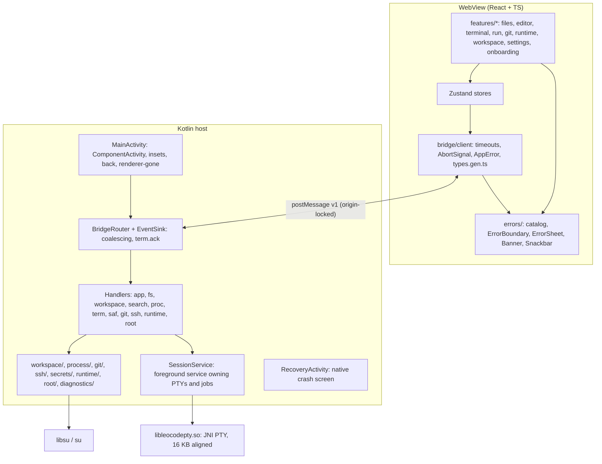
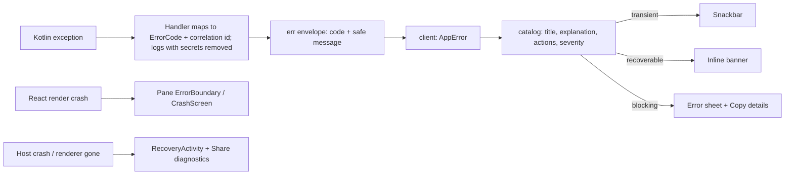

# LeoCode — Implementation Plan v9

Android coding IDE. **Source of truth.** Supersedes [v8](LeoCode_Implementation_Plan_v8.md), which is kept as history.

**Status (2026-11-11):** Phase 0 gates 0B/0E pass on Android 9 and the IDE shell runs on device 1. The app is not production-grade yet: the bridge path jail is bypassed, release builds are debug-signed, two files hold most of the logic, and errors are reduced to `e.message`. v9 restructures and hardens what exists, then completes the 0.1 MVP. Task tracking lives in [`PROGRESS.md`](../PROGRESS.md).

**What changed from v8**
1. Scope is now two-part: **harden and restructure** the existing app (Phases A–C), then build the **full 0.1 MVP** (Phases D–H).
2. **Optional root mode** (D-011). Rooted and unrooted phones are both supported; root features are opt-in and invisible otherwise.
3. **Python uses the official python.org Android build** plus our own NDK launcher (D-012, amends D-006). `scripts/build-python.sh` is retired.
4. **Typed error model and Material 3 error surfaces** (§7). Nothing fails silently; no raw stack traces.
5. **Local-only diagnostics** with a native crash recovery screen (D-013).
6. **Device matrix changed** (D-014): real phones only, no emulators. D1 Android 9 unrooted, D2 Android 15 rooted.
7. **Code structure fixed**: manual DI (`AppGraph`), per-domain bridge handlers, Zustand feature stores (D-015).
8. 16 KB page-size support, a foreground session service, and Android 12+ process-killer handling are now explicit tasks.
9. **Python is the primary language (D-017, added 2026-11-11).** LeoCode's main purpose is writing and running code, so one language must work end to end before any other is added. Python is that language. Python tasks (24–26 plus new 30–33) move ahead of Git/SSH and root mode, and "well supported" is defined by an acceptance suite (§9.1). Node.js, Java and PHP stay deferred behind a language-provider interface.
10. **D2 is not rooted yet** (verified 2026-11-11: no `su`, no root manager). The owner will root it (Magisk) before Phase E. Everything else treats D2 as an unrooted Android 15 phone until then.

**Reading order:** §1 decisions → §4 execution model → §5–7 architecture and errors → §15 tasks.

---

## Devices

| ID | Device | Android | Root | Role | Connection |
|---|---|---|---|---|---|
| **D1** | Redmi Note 7S (`lavender`), 4 GB, MIUI V11 | 9 (API 28) | No | Old-Android, low-RAM, MIUI reference; regression baseline | Wi-Fi ADB |
| **D2** | POCO F1 (`beryllium`), LineageOS build `lineage_beryllium-user` | 15 (API 35) | **Not yet.** Owner will root (Magisk) before Phase E | New-Android behaviour, 16 KB check; root mode once rooted | USB |
| X1 | Snapdragon 695 phone | 11 | No | Optional, not available | — |
| X2 | Stock Android 14+ phone | 14+ | No | Optional, not available | — |

- "No device integrity" does not matter: LeoCode uses no Play Integrity or SafetyNet.
- **D2 is unrooted today** (checked with read-only `adb` commands: no `su`, no Magisk/KernelSU/APatch package). Until it is rooted, D2 is the unrooted Android 15 reference. After rooting, unrooted behaviour is re-checked by denying `su` to LeoCode (Magisk DenyList / revoke).
- Both phones report 4096-byte pages. **No device exercises 16 KB pages at runtime**; 16 KB support is verified only by the static ELF/`zipalign` check in CI.
- **Android 10–14 are not verified on hardware.** They sit between D1 and D2; release notes say so (§4.2).
- **No emulators.** The laptop is too weak. Heavy builds (CPython, wheels, signed releases) run on GitHub Actions.

**Dev environment:** Linux Mint laptop, one USB cable, GitHub Actions.

---

## 1. Decisions

D-001…D-010 are unchanged from v8 unless noted. Full records: [`decisions/README.md`](decisions/README.md).

| ID | Decision | Choice | Status |
|---|---|---|---|
| D-001 | Distribution | Direct APK via GitHub Releases. Not Google Play. | Frozen |
| D-002 | SDK levels | targetSdk **28**, compileSdk 34+, minSdk 28 | Frozen (countdown, §4) |
| D-003 | Package ID | `dev.leocode` | Final |
| D-004 | Terminal | xterm.js + own JNI PTY, no GPL | Frozen |
| D-005 | Git/SSH | JGit + MINA SSHD + Bouncy Castle, in-process | Frozen; JGit version via D-016 |
| D-006 | Python | System shell + CPython (Track C2); userspace rebuild (C1) deferred | **Amended by D-012** |
| D-007 | WebView minimum | Chromium 100+, hard gate; degraded mode is policy | Frozen |
| D-008 | Shared UID | Executed code has the app's UID; documented and mitigated | Frozen |
| D-009 | Secrets | Keystore-wrapped AES-GCM envelope; no plaintext key files | Frozen |
| D-010 | Preview | Separate WebView, `127.0.0.1`, random port + token | Frozen (post-Node) |
| **D-011** | Root | Optional root mode via libsu; no prompt at startup; path jail stays; root kill via `su` | **New** |
| **D-012** | CPython source | Official python.org Android build + NDK `python3` launcher + cibuildwheel wheels | **New** |
| **D-013** | Diagnostics | Local only: recovery screen + redacted Copy/Share. No network upload. | **New** |
| **D-014** | Device matrix | D1 (A9 unrooted) + D2 (A15 rooted), real devices only, 10–14 unverified | **New** |
| **D-015** | Structure | Manual DI (`AppGraph`) on Android; Zustand stores on the web | **New** |
| **D-016** | JGit version | 6.x vs 5.13.x — decided by the Task 19 spike | **Open** |
| **D-017** | Primary language | **Python first.** One language is supported end to end before any other; others plug in later through a language-provider interface | **New** |

---

## 2. Requirements

1. **Android 9 through 16** (API 28–36), `arm64-v8a`. 32-bit-only devices are documented as unsupported.
2. **Rooted and unrooted.** Optional root mode: detect `su` without prompting; opt-in root terminal session and a "Run as root" toggle with a warning and a visible ROOT badge. Unrooted users see no change. The path jail stays (no root file browsing).
3. **Scope:** harden and restructure the existing features, then the full 0.1 MVP (workspaces, crash-safe editing, Git/SSH UI, Python runtime install).
4. **Graceful errors, Material 3 look:** snackbars for transient messages, inline banners for recoverable problems, bottom sheets with error code + one primary action + "Copy details" for blocking errors, and a full-screen recovery screen for crashes. No raw stack traces. Nothing fails silently.
5. **Diagnostics are local only:** crash recovery screen plus "Copy / Share diagnostics" with secrets and outside paths redacted.
6. **Real devices only** (§Devices, §12). One phone on USB, the other on Wi-Fi ADB.
7. **Python:** official python.org Android build + our NDK launcher; native wheels via cibuildwheel.
8. **Python is the primary language (D-017).** It is supported first and supported well (§9.1). Other languages are added later and must not delay it.
9. **Order of work:** Python (Phase G) comes right after the web restructure (Phase C), before workspaces, Git/SSH and root mode. The Python CI artifact job (Task 24) can start at any time because it needs no app changes.
10. **Docs:** v9 replaces v8; `PROGRESS.md` follows the v9 tasks.

---

## 3. Starting point (audit, 2026-11-11)

What works on D1: file explorer (search, 6 sort modes, properties, binary/dotfile filters, device-wide shared-storage browsing), multi-tab CodeMirror editor with session restore, live PTY terminal, run sheet with group-kill Stop, themes, runtime manager UI, nightly CI APK.

What blocks production:

| Area | Finding | Fixed by |
|---|---|---|
| Security | `WebAppBridge.resolve()` uses `File.normalize()` and a `startsWith` check instead of `Workspace.jail()`. Any absolute path is accepted (`/system`, `/proc`), symlinks are not resolved, `/data/data/dev.leocodeX` passes. Tests cover `jail()`, which production never calls. | Task 4 (fixed 2026-11-11) |
| Security | `HarnessActivity` is exported with no permission in the main manifest. | Task 4 (fixed 2026-11-11) |
| Security | No CSP; Google Fonts loaded at runtime. | Task 8 |
| Release | Release build signed with the debug key; R8 off; public debug APK on every push to `main`. | Task 28 |
| Structure | `WebAppBridge.kt` 728 lines: one `when` over 20 methods, untyped `JsonObject` payloads, raw threads, unbounded cached pool, no backpressure. | Tasks 5–6 |
| Structure | `App.tsx` `Shell` ≈ 970 lines: 16 `useState`, 9 `useEffect`, 21 `useCallback`. `styles.css` 2 488 lines. | Task 13 |
| Structure | `ProcessHost` and `WebAppBridge.runProcess` duplicate process launch; PTY path inherits the full app environment, ProcessBuilder clears it. | Task 6 |
| Errors | String-literal codes; `E_INTERNAL` leaks exception text; UI shows `e.message`; silent `catch {}` blocks; no ErrorBoundary; no bridge timeouts; single-slot SAF/permission callbacks that hang the second caller. | Tasks 5, 11, 12 |
| Errors | No `onRenderProcessGone` (renderer crash kills the app); no uncaught-exception handler. | Task 8 |
| Android | No 16 KB page alignment; no foreground service (sessions die with the Activity and under the phantom-process killer); plain `android.app.Activity`, deprecated `onBackPressed` and `systemUiVisibility`. | Tasks 2, 8, 10 |
| Native | `pty.c` calls `setenv` after `fork`, leaks inherited fds, does not reset signals, uses `ptsname`. | Task 9 |
| Tooling | No web tests or ESLint; no instrumented tests; CI does not run unit tests; lint non-blocking; actions unpinned; `contents: write` globally; `gradle.properties` hard-codes `org.gradle.java.home=/home/sourav/jdk17`; CI NDK fallback (27.2) differs from the pin (27.0). JGit/SSHD/BC declared but unused. | Tasks 2, 19 |
| Features | Not built: workspaces, crash-safe editing, search, Git/SSH UI, Python install. | Phases D–G |

---

## 4. Execution model and Android-version constraints

### 4.1 targetSdk 28 is a countdown clock
Apps targeting API 29+ cannot `execve()` files written to their data directory, so LeoCode targets 28 (as Termux does). Consequences:
- No Google Play (D-001).
- Install floors rise: Android 14 refuses targetSdk < 23, Android 15 refuses < 24. When a release refuses < 29, switch to plan B (§14). Check every Android release.
- Legacy storage: with targetSdk ≤ 29, scoped storage is not enforced, so `READ/WRITE_EXTERNAL_STORAGE` still grant shared-storage access. Verify on D2 (Task 3).

### 4.2 What applies to a targetSdk-28 app
Most behaviour changes are gated on the app's targetSdk and do **not** apply. The rows marked **All apps** are tested on D2.

| Android | Change | Applies to LeoCode? | Handled by |
|---|---|---|---|
| 10 | W^X `execve` block for app-written files | No (targetSdk ≥ 29 only) | D-002 |
| 10 | Scoped storage | No (targetSdk ≥ 29/30) | — |
| 10 | Background activity starts blocked | All apps | We never start activities from background |
| 11 | Package visibility, scoped storage enforcement | No (targetSdk ≥ 30) | — |
| 12 | **Phantom-process killer** (child processes killed when backgrounded / over limit) | **All apps** | Task 10 (foreground service, guide, root option) |
| 12 | System splash screen | All apps | Keep the web splash consistent with it (Task 8) |
| 12 | `android:exported` required, FGS start-from-background limits | No (targetSdk ≥ 31) | Declared anyway (Task 4, 10) |
| 13 | **Notification permission**: for targetSdk ≤ 32 the system prompts when the first channel is created | **All apps** | Task 10 |
| 14 | Install floor targetSdk 23 | All apps (we pass) | — |
| 14 | Foreground-service types required | No (targetSdk ≥ 34) | A plain FGS without a type is fine at targetSdk 28; add a type if the target rises |
| 15 | Install floor targetSdk 24 | All apps (we pass) | Task 3 records install on D2 |
| 15 | **16 KB page-size devices** | **All apps with native code** | Task 2 (alignment), Task 24 (Python libs) |
| 15 | Edge-to-edge enforced | No (targetSdk ≥ 35) | Task 8 does insets anyway |
| 15/16 | Old-target warning dialog at launch | Possibly | Task 3 records whether it appears |
| 16 | Predictive back by default | No (targetSdk ≥ 36) | Task 8 uses `OnBackPressedDispatcher` |

Cells marked "Possibly" or needing confirmation are measured in Task 3, not assumed.

### 4.3 16 KB pages
Android 15 supports 16 KB-page devices. A `.so` built with NDK r27 or lower without flags can fail to load or crash with `SIGSEGV` when `GNU_RELRO` shares a page with writable data. Fix: NDK r28+ (16 KB default) or `-Wl,-z,max-page-size=16384` plus RELRO-safe flags on r27. CI checks every `.so` in the APK and in runtime packages with `zipalign -c -P 16 -v 4` and `llvm-readelf -Wl` (all `LOAD` align ≥ `2**14`). Source: [Android developers — page sizes](https://developer.android.com/guide/practices/page-sizes).

### 4.4 Storage model
- **Workspaces** live in app-private storage (`filesDir/workspaces/<id>`). Scripts and binaries run only from here.
- **Shared storage** (`/sdcard`, when the storage permission is granted) is a second jailed root for browsing and editing. Shared storage is mounted `noexec`; `sh script.sh` works there, binaries do not.
- **SAF** is copy-in/copy-out for providers that are not plain files (cloud, USB).
- Everything else (`/system`, `/proc`, other apps' data, `/data/data/dev.leocodeX`) is rejected with `E_PATH_OUTSIDE_ROOT`.

---

## 5. Architecture



**Rules** (v8 rules plus v9 additions)
- The React UI knows nothing about Android; all platform access goes through the versioned bridge.
- Every long operation is async and streams events. No file I/O, hashing, Git or `su` on the main thread.
- Output is bounded and coalesced (16 ms) with `term.ack` credit, so floods cannot freeze the WebView.
- Git/SSH never depend on a runtime being installed.
- A generic runtime-provider interface exists before Python is wired in.
- One process-launch path (`ProcessSupervisor`) and one child-environment builder for both ProcessBuilder and PTY children.
- Sessions (PTYs, jobs) are owned by `SessionService`, not by the Activity.
- Handlers never throw raw exceptions to the router: every failure becomes an `ErrorCode` (§7).
- `AppGraph` constructs every service once in `LeoApp`; Activities and handlers receive dependencies, they do not construct them.
- Native code is limited to the PTY library and the Python launcher.

---

## 6. Module layout

```
android/app/src/main/java/dev/leocode/
  LeoApp.kt                 Application: builds AppGraph, installs crash handler
  AppGraph.kt               manual DI: one instance of each service
  host/        MainActivity, WebViewFactory, Insets, RecoveryActivity
  bridge/      Envelope, ErrorCode, BridgeException, BridgeRouter, EventSink
  bridge/handlers/  AppHandler, FsHandler, WorkspaceHandler, SearchHandler, ProcHandler,
                    TermHandler, SafHandler, GitHandler, SshHandler, RuntimeHandler, RootHandler
  workspace/   PathJail, AtomicWriter, Trash, Drafts, WorkspaceStore, Search
  process/     ProcessSupervisor, ChildEnv, PtySession, NativePty, SessionService, OrphanReaper
  root/        RootManager, RootCommand
  git/         GitService, progress + error mapping
  ssh/         KeyManager, HostKeyStore, SshSessionFactory
  secrets/     SecretStore (Keystore envelope)
  runtime/     ManifestVerifier, Downloader, SafeExtractor, RuntimeStore, TrustStore
  language/    LanguageProvider, PythonProvider (D-017), TracebackParser
  diagnostics/ CrashStore, Redactor, DiagnosticsReport
android/app/src/debug/java/dev/leocode/
  HarnessActivity            Phase 0 tests T1–T15, debug builds only
android/app/src/main/cpp/
  pty.c, python_launcher.c (Task 24, may live in runtime-packaging/ instead)

web/src/
  app/          App, Shell (< 200 lines), routes, boot
  bridge/       client.ts, android.ts, mock.ts, types.gen.ts (generated)
  errors/       AppError, catalog.ts, ErrorBoundary, CrashScreen
  notifications/  snackbar queue store + Snackbar host
  stores/       cross-feature stores (settings, session)
  ui/           tokens, Sheet, Banner, Button, Icons
  features/     files, editor, terminal, run, git, runtime, workspace, settings, onboarding, root
```

---

## 7. Error model

### 7.1 Flow



### 7.2 Codes
Kotlin `ErrorCode` enum is the single source; the TS union is generated (Task 7). Full table in [`bridge-contract.md`](bridge-contract.md).

| Group | Codes |
|---|---|
| Protocol | `E_BAD_ENVELOPE`, `E_UNKNOWN_METHOD`, `E_UNSUPPORTED` (version / feature), `E_TIMEOUT`, `E_CANCELLED`, `E_BRIDGE_DISCONNECTED` (web side only) |
| Files | `E_PATH_OUTSIDE_ROOT`, `E_NOT_FOUND`, `E_NOT_DIR`, `E_EXISTS`, `E_BINARY`, `E_IO`, `E_DISK_FULL`, `E_CONFLICT` (also Git) |
| Platform | `E_PERMISSION`, `E_LIMIT`, `E_BUSY` |
| Runtime | `E_NO_RUNTIME` |
| Network / auth | `E_OFFLINE`, `E_AUTH`, `E_HOSTKEY_CHANGED` |
| Root | `E_ROOT_UNAVAILABLE`, `E_ROOT_DENIED` |
| Fallback | `E_INTERNAL` — safe message + correlation id only; details go to the redacted log |

### 7.3 Surfaces

| Severity | Surface | Use for | Example |
|---|---|---|---|
| Info / transient | **Snackbar** (bottom, 4 s, one action) | Completed actions, cancellations, undo | "Moved to trash · Undo"; "Picker cancelled" |
| Recoverable | **Inline banner** (in the affected pane) | State the user can fix while continuing | "Python not installed · Install"; "File changed on disk · Reload / Keep mine"; "Restored after a problem" |
| Blocking | **Error sheet** (bottom sheet) | Action failed and needs a decision | "Couldn't save — storage full · Free space" |
| Fatal (web) | **Pane ErrorBoundary / CrashScreen** | A React render crash | Pane shows "This panel stopped working · Reload panel" |
| Fatal (host) | **RecoveryActivity** (native, no WebView) | Uncaught Kotlin exception or repeated renderer loss | "LeoCode closed unexpectedly · Restart / Share diagnostics" |

### 7.4 Copy rules
- Say **what failed**, **why** (in plain words), and offer **one primary action** (Retry / Open settings / Grant / Install / Free space). A secondary "Copy details" is always available on sheets.
- Never show a stack trace, exception class name, or a path outside the workspace or shared-storage roots.
- "Copy details" contains: code, correlation id, method, app version, Android version, WebView version, root state, and a redacted one-line summary.
- Every code has a catalog entry (`web/src/errors/catalog.ts`); a test fails if one is missing (Task 12).
- `catch {}` without handling is forbidden (ESLint rule, Task 2/12). Expected failures (e.g. user cancels a picker) map to `E_CANCELLED` and show a snackbar or nothing by explicit choice.

### 7.5 Redaction
`Redactor` (Kotlin) and the web summary builder remove: tokens and key material, `Authorization` headers, URLs' user-info, environment values, and paths outside allowed roots (replaced by `<outside>`). Used by logs, Copy details, crash files and diagnostics share.

---

## 8. Root mode (D-011)

- **Detection without prompting:** `RootManager.status()` checks whether an `su` binary is present (libsu `Shell.isAppGrantedRoot()` returns null until asked). Unrooted users never see a prompt.
- **Opt-in:** Settings › Advanced › Root mode. Turning it on shows a warning sheet ("Commands can change or break your system. LeoCode cannot undo them."), then requests the grant.
- **Features:** "New root session" in the terminal (PTY running `su`); "Run as root" toggle on the run sheet (`proc.run` with `root: true` → `su -c '<quoted>'`).
- **Visibility:** ROOT badge on root terminal tabs, the run sheet and the status bar while any root process is alive.
- **Kill path:** the app UID cannot signal root processes, so cancel sends the signal through `su` (`kill -TERM -<pgid>`, then `-KILL`). The pgid is recorded at start.
- **Lost grant:** revocation mid-session ends the session with a banner; next use returns `E_ROOT_DENIED`.
- **Unchanged:** the path jail; bridge methods never accept root file paths. Root is never requested at startup.
- **Phantom-process option:** on rooted phones, Task 10 can offer to run `device_config put activity_manager max_phantom_processes 2147483647` (Android 12+) with explanation; it is never applied silently.
- **Library:** [libsu](https://github.com/topjohnwu/libsu) `core` (Apache-2.0), JitPack.

---

## 9. Python (D-012)

- **Source:** official python.org Android release for `aarch64` (Android is a tier-3 platform since 3.13, PEP 738). Pin the latest stable version that ships an Android package, with its sha256. Task 24 confirms availability and whether the package already contains an executable.
- **Launcher:** the official build is designed for embedding (`libpython3.x.so`). We build a ~20-line `python3` executable calling `Py_BytesMain` with NDK r28, linked against that `libpython`.
- **Package:** `.tar.gz` with `bin/python3` (+ `python` link), `lib/libpython*.so`, stdlib, pip, certifi CA bundle. 16 KB alignment checked.
- **Prefix:** computed from `filesDir` at runtime (`<filesDir>/usr`), never hard-coded to `/data/data/...`, so secondary users and work profiles work. `#!` lines stay short (`/data/user/0/dev.leocode/files/usr` = 34 chars); prefer `python -m` entry points.
- **Environment:** `PYTHONHOME`, `SSL_CERT_FILE`, `PATH=<prefix>/bin:/system/bin`, `HOME`, `TMPDIR`, `TERM`, `LANG` from one `ChildEnv` builder.
- **Wheels:** cibuildwheel builds Android wheels (start with `markupsafe`); also check whether pip installs PyPI Android wheels directly. Our index is a signed static site.
- **Integrity:** Ed25519-signed manifest (offline key, protected GitHub environment), rollback counter, verify before extraction (§11).
- **Limits:** no compiler on device; sdists with C code fail; manylinux wheels never install. Published in [`compatibility.md`](compatibility.md).

### 9.1 What "Python is supported well" means (D-017)

Python is the first and, for 0.1, the only language with first-class support. The acceptance suite below is the bar; Tasks 24–26 and 30–33 deliver it. Each line is tested on D1 and D2 and recorded in `test-matrix.md`.

| Area | Must work |
|---|---|
| Install | One-tap install from the Runtime tab or the "Python not installed" banner; resumable; signed; health check; repair/uninstall |
| Run | Run the current `.py` file, a module (`python -m pkg`) or a project entry point; stdout/stderr streamed; exit code shown; Stop kills the whole process group |
| Input | `input()` works in the run sheet (stdin field) and in the terminal |
| Errors | Python tracebacks become tappable `file:line` links that jump to the line in the editor; `SyntaxError` and runtime errors show a short plain-language summary above the raw output |
| REPL | "Python REPL" session opens `python3 -i` in the terminal with history and Ctrl+C/Ctrl+D |
| Packages | `pip install` from the terminal or a `requirements.txt` prompt; per-project `.venv` created and selected automatically; pure-Python packages and published Android wheels install; failures explain *why* (no wheel, needs a compiler) |
| Editor | Python highlighting, 4-space auto-indent after `:`, dedent on `return`/`pass`, bracket closing, comment toggle, indent guides, Python-aware snippets (`def`, `class`, `if __name__`) |
| Project | "New Python project" template (`main.py`, `requirements.txt`, `.gitignore`, `.venv` created on first run) |
| Safety | Trust prompt before running a project's code, `pip install` or activating a venv (§11) |
| Limits | Documented in-app (Runtime tab → Compatibility): no compiler, no manylinux wheels, which popular packages work (from `compatibility.md`) |

**Language-provider interface.** A `LanguageProvider` (Kotlin) and matching web descriptor define what a language contributes: runtime id, file extensions, run command builder, REPL command, environment, project template, trust-prompt triggers, traceback parser. Python is the first implementation. Adding Node.js, Java or PHP later means writing a provider and a runtime package, not changing the bridge or the UI shell. Nothing outside the provider may hard-code `python`.

---

## 10. Git and SSH

- **JGit** in-process. 6.x needs Java 11 APIs, some missing on API 28; 5.13.x targets Java 8. The Task 19 spike tests 6.x first and falls back; the result is D-016.
- **Operations (0.1):** init, clone (progress, cancel), status, add, reset, commit, diff, log, branch, checkout, fetch, pull, push, conflict detection and per-block resolution.
- **Auth:** HTTPS token (stored in `SecretStore`) and SSH keys via MINA SSHD + Bouncy Castle (Ed25519 on API 28).
- **Keys:** generate Ed25519/RSA; import OpenSSH, PEM, PKCS#8; passphrases; copy public key. Stored only as Keystore-wrapped blobs (D-009).
- **Host keys:** `known_hosts` with SHA-256 fingerprints; first connect emits `ssh.hostkey.prompt` and waits for `ssh.hostkey.answer`; a changed key is a hard failure (`E_HOSTKEY_CHANGED`).
- **Known JGit gaps:** no hooks execution by default, no LFS, limited submodule/shallow behaviour. Documented in-app.

---

## 11. Security and threat model

Carried from v8 §9 with v9 updates.

**Assets:** SSH keys, HTTPS tokens, project source, runtime integrity, the device (more so with root).

**Threats:** malicious repo (hooks, `setup.py`), malicious package, malicious preview content, compromised update host, other apps, malicious imported file/intent, terminal escape attacks, shared-UID snooping, **accidental root damage**.

- **Path jail (fixed in Task 4):** every bridge path is canonicalised (symlinks resolved) and must sit under an allowed root: the active workspace root, other workspaces, or shared storage when permission is granted. Prefix check uses root + separator. Everything else → `E_PATH_OUTSIDE_ROOT`.
- **Shared UID (D-008):** keys encrypted at rest, plaintext only in memory for one operation, no secrets in child environments, onboarding warning that cannot be skipped silently.
- **Trust prompt** (per project, remembered by a hash of relevant files) before running scripts, `pip install`, venv activation, Git hooks, auto-run tasks (Task 26).
- **Root (D-011):** opt-in, warned, badged, never at startup, never through file APIs; root commands are argv-quoted, not string-concatenated from untrusted input.
- **Bridge:** origin allowlist (release: `https://appassets.androidplatform.net` only), `v` check, schema-validated DTOs, method allowlist (no generic exec, no arbitrary path API), size limits, no secrets across the bridge, `E_INTERNAL` without exception text.
- **WebView:** file/content/universal access off; strict CSP with no remote origins; fonts bundled; debugging off in release; no `addJavascriptInterface`; renderer-gone handled.
- **Terminal:** OSC 52 clipboard writes disabled, answerback disabled, titles sanitised, output rendered only by xterm.js.
- **Android:** `allowBackup=false`; `HarnessActivity` debug-only; minimal exported components; no world-readable files; release `debuggable=false`.
- **Supply chain:** signed runtime manifests with rollback counters; safe extraction (Task 25); pinned CI actions; least-privilege CI permissions; signing keys in a protected environment never exposed to fork PRs; SBOM per release.
- **Native:** 16 KB-aligned; PTY child uses `execve` with an explicit environment and closes inherited fds.

---

## 12. Device workflow

- **D2 (Android 15) on USB.** It needs the most installs and is the only rooted and new-Android device.
- **D1 (Android 9) on Wi-Fi ADB**, same home network:
  ```bash
  adb -s <d1-usb-serial> tcpip 5555      # while D1 is on USB
  adb -s <d1-usb-serial> shell ip addr show wlan0
  adb connect <d1-ip>:5555               # then unplug D1 and plug in D2
  adb devices -l                         # both listed
  ```
  Re-enable after every D1 reboot (needs USB again). Android 15 also has built-in Wireless debugging in Developer options, so the roles can be swapped.
- **Fallback:** if Wi-Fi ADB is unreliable, connect one phone at a time; each task's demo names the phone(s) and is run as a checkpoint.
- **Scripts** take `LEO_D1` / `LEO_D2` serials (`scripts/devices.sh`, Task 3), e.g. `scripts/smoke.sh "$LEO_D2"`.
- **Rule:** a result counts only on the device where it was measured ([`test-matrix.md`](test-matrix.md)).

---

## 13. CI, release and licensing

- **Jobs:** `web` (typecheck, ESLint, vitest, build), `android` (`./gradlew` unit tests, blocking lint with baseline, assemble, ELF/zipalign 16 KB check, generated-types drift check, CSP check), `python-runtime` (Task 24), `release` (on tag, Task 28).
- **Rules:** actions pinned to SHAs; per-job least-privilege `permissions`; `npm ci`; signing keys and the manifest-signing key only in protected environments; nightly builds become **signed prereleases**, not public debug APKs; SBOM (CycloneDX) per release; heavy work on CI, not the laptop.
- **Build:** JDK path not in the repo (`~/.gradle/gradle.properties` locally); NDK pinned identically locally and in CI.
- **Release:** one release key, generated and backed up by the owner. R8 on with keep rules for JGit, SSHD, BC, kotlinx-serialization. Version from the git tag.
- **Self-update:** signed release manifest → HTTPS download → verify the APK signing certificate matches the installed app → hand to the system installer (`REQUEST_INSTALL_PACKAGES`). Never silent. Document MIUI's scanner prompt.
- **Licensing:** no GPL in the APK. CPython PSF; JGit EDL/BSD; MINA SSHD Apache-2.0; Bouncy Castle MIT; libsu Apache-2.0; commons-compress Apache-2.0; xterm.js MIT; CodeMirror MIT; Zustand MIT. App license still TBD.

---

## 14. Plan B — decision tree

Carried from v8 §14, extended for D2.

```
T2 exec fails on D2 (Android 15)?     → check SELinux/ROM; try with root denied; if exec is blocked for
                                        targetSdk 28 on 15 generally → B1 (Termux backend) or B4.
Install refused on a new Android?      → targetSdk floor reached → B1 for that version; keep 28 elsewhere.
WebView < 100 and not updatable?       → degraded mode (v8 §6 0A). If editor and bridge both degrade → B4.
Official CPython build unusable?       → back to scripts/build-python.sh (C2 custom) → B2 → B3.
JGit 6.x and 5.13.x both fail on 28?   → design bug, not a platform limit; investigate desugaring.
Terminal fails IME criteria?           → GPL Termux view only if the app goes GPL; else line-mode runner.
Root mode unstable on a ROM?           → root mode stays off for that ROM; core app unaffected.
```

| Option | Product | Cost | Trade |
|---|---|---|---|
| B1 | LeoCode + Termux backend via `RUN_COMMAND` | 8–12 weeks | Needs Termux; non-interactive terminal; works on every Android |
| B2 | Full userspace rebuild (Track C1) | +3–5 weeks, ongoing | Broad pip/npm; maintenance burden |
| B3 | Embedded interpreter only | 2–3 weeks | "Run this project", not a dev environment |
| B4 | Remote workspace over SSH | 4–6 weeks | No local execution |

---

## 15. Task breakdown

**Execution order (D-017: Python first).** Phase letters group tasks; they are not the order of work. Build in this order:

1. **A** (1–3), fixing the Phase A findings first ([`reports/phase-a-analysis.md`](reports/phase-a-analysis.md))
2. **B** (4–10) host restructure
3. **C** (11–13) web restructure and error UX
4. **G** Python (24–26, 30–33): the primary language, so it comes *before* D, E and F
5. **D** (14–16) workspaces, crash-safe editing, search
6. **F** Git/SSH (19–23)
7. **E** root mode (17–18), once D2 is rooted
8. **H** (27–29) hardening and release

Task 24 (CI artifact) needs no app changes, so it can start as soon as Task 2 is green. Task 4 (path jail) must land before any Python installer code is accepted, since the installer touches the file system.

Every task ends with a demo on the phones it names. A task is done only when its tests pass and its demo is recorded in [`test-matrix.md`](test-matrix.md) or [`PROGRESS.md`](../PROGRESS.md).

### Phase A — Docs and foundation

**Task 1: Write the v9 documentation set** — *done 2026-11-11*
- Objective: put the plan in `docs/` as the new source of truth.
- Guidance: this file; v8 marked superseded; D-011…D-016 in `decisions/README.md`; `bridge-contract.md`, `ux-spec.md`, `test-matrix.md`, `compatibility.md`, `phase0-runbook.md` updated; `PROGRESS.md` rebuilt; `docs/README.md` and root `README.md` point to v9.
- Tests: all relative links resolve; every v8 item appears in §18 as a task or deferred.
- Demo: open `docs/README.md` and follow the reading order to v9.

**Task 2: Build and CI hygiene, 16 KB alignment**
- Objective: reproducible builds; native code safe on 16 KB devices.
- Guidance:
  - Move `org.gradle.java.home` from `android/gradle.properties` to `~/.gradle/gradle.properties`.
  - NDK r28 (or alignment + RELRO flags on r27); same NDK in CI and locally; remove the 27.2 fallback mismatch.
  - Bump AGP/compileSdk only as far as androidx requires; **targetSdk stays 28**.
  - Add `scripts/check-elf-alignment.sh` (`llvm-readelf -Wl` on each `.so`, `zipalign -c -P 16 -v 4` on the APK) and run it in CI.
  - CI: pin actions to SHAs, per-job least-privilege `permissions`, `./gradlew`, run `testDebugUnitTest`, lint blocking with a baseline.
  - Web: vitest + ESLint (typescript-eslint, react-hooks, `no-empty` for `catch`) with one sample test.
- Tests: CI runs web tests, unit tests, lint and the alignment check.
- Demo: CI green; APK installs and launches on D1 and D2.

**Task 3: Device tooling and D2 baseline**
- Objective: prove the feasibility gates hold on Android 15 before restructuring.
- Guidance:
  - `scripts/devices.sh`: resolve `LEO_D1` / `LEO_D2`, print model/Android/root state; document Wi-Fi ADB (§12).
  - `scripts/smoke.sh <serial>`: install, launch, `am start -W` cold-start time, logcat capture.
  - Run `collect-device-report.sh` and harness T1–T7 on D2.
  - Record: WebView version (gate ≥ 100), `PAGE_SIZE`, targetSdk-28 install result, any old-target warning dialog, shared-storage access with legacy permissions, notification prompt behaviour.
  - Optional: `T2c` control build at targetSdk 29 on D2 to document the exec block.
- Tests: T1–T7 pass on D2. Any failure triggers §14.
- Demo: `test-matrix.md` D2 column filled, including T2 exec-from-data on Android 15.

### Phase B — Android host restructure

**Task 4: Fix the path jail and file safety**
- Objective: close the security hole without breaking the shared-storage explorer.
- Guidance:
  - `PathJail` with a list of allowed roots: workspace roots, plus the canonical shared-storage root only while the storage permission is granted. Canonicalise (resolve symlinks), check `root + File.separator` prefix, reject absolute paths outside every root and symlink escapes. All bridge paths go through it.
  - `AtomicWriter`: unique temp file in the same directory, write, `fsync`, rename over the target (no delete first).
  - `Trash`: move within the same filesystem (workspace `.trash`, shared storage `.leocode-trash`); copy-then-delete fallback; never a silent permanent delete; purge after 30 days.
  - Size limits: incoming message 256 KB, `fs.write` content, SAF reads.
  - Move `HarnessActivity` to the debug source set.
- Tests: JVM tests for traversal, absolute paths, symlinks, `dev.leocodeX` prefix, shared-storage root with and without permission, concurrent atomic writes, trash.
- Demo: on D1, `fs.read("/sdcard/..")` and `fs.read("/system/build.prop")` return `E_PATH_OUTSIDE_ROOT`; normal file operations in the workspace and `/sdcard` still work.

**Task 5: Typed error model and router (`app.*`, `fs.*`)**
- Objective: replace the single `when` for two domains with no behaviour change.
- Guidance: `ErrorCode` enum + `BridgeException`; `BridgeRouter` method → handler map; `AppHandler`, `FsHandler` with `@Serializable` DTOs; coroutines on a bounded IO dispatcher with a `SupervisorJob`; check `v`; `E_INTERNAL` returns a safe message + correlation id, details go to the redacted log. `AppGraph` and `LeoApp` introduced here.
- Tests: router tests (unknown method, bad envelope, version mismatch, error mapping); `FsHandler` tests on a temp directory.
- Demo: file explorer parity on D1.

**Task 6: Migrate `proc`, `term`, `saf`, `storage` with backpressure**
- Objective: finish the router, remove duplicated process code, make floods harmless.
- Guidance: `ProcHandler`, `TermHandler`, `SafHandler`; `ProcessSupervisor` replaces `ProcessHost` and `runProcess`, with one `ChildEnv` builder; `EventSink` coalesces at 16 ms and grants credit via `term.ack`; stop = SIGTERM, wait 2 s, SIGKILL; SAF/permission requests keyed by request id (no single-slot callbacks); delete `WebAppBridge.kt`.
- Tests: supervisor tests (exit code, timeout, cancel, output cap without splitting UTF-8); `EventSink` coalescing test.
- Demo: `yes` in the terminal on D1 keeps the UI responsive; Stop leaves no child processes (`ps` checked).

**Task 7: Generated TS types**
- Objective: Kotlin and TS contracts cannot drift.
- Guidance: Gradle task `generateBridgeTypes` walks the serial descriptors of the DTOs and writes `web/src/bridge/types.gen.ts`, including the `ErrorCode` union; the web code switches to the generated types.
- Tests: CI regenerates and runs `git diff --exit-code`.
- Demo: renaming a DTO field breaks `tsc` until types are regenerated.

**Task 8: Activity modernisation and crash recovery**
- Objective: the app survives and recovers from failures on Android 9–15.
- Guidance:
  - `ComponentActivity` with ActivityResult APIs and `OnBackPressedDispatcher`.
  - Edge-to-edge via `WindowInsetsCompat`, passed to the page as CSS variables (`--inset-top`, `--inset-bottom`, `--ime-bottom`).
  - `onRenderProcessGone` recreates the WebView and shows "Restored after a problem"; two losses within a minute → `RecoveryActivity`.
  - `onReceivedError` for the asset origin.
  - Uncaught-exception handler → `CrashStore` → next launch opens native `RecoveryActivity` (Restart, Share diagnostics redacted).
  - Strict CSP meta tag, fonts bundled locally.
- Tests: `Redactor` unit tests; CI check that `index.html` has no remote origins.
- Demo on D1 and D2: debug-only renderer kill recovers; debug-only forced crash opens `RecoveryActivity`; back closes sheets → Files → exit.

**Task 9: Native PTY correctness**
- Objective: the PTY child starts cleanly and safely.
- Guidance: in `pty.c`, `execve` with an environment array prepared before `fork` (no `setenv` after fork); close fds ≥ 3; reset signal mask and dispositions; `ptsname_r`; check `TIOCSCTTY`. Kotlin guards `resize`/`write` after close.
- Tests: harness T8 (child environment contains only allowlisted keys), T9 (no fds > 2 in the child); T6 still passes.
- Demo: harness passes on D1 and D2.

**Task 10: SessionService for background survival**
- Objective: terminals and jobs survive backgrounding and Activity recreation.
- Guidance:
  - Foreground service owns PTYs and jobs; notification "N processes running" with Stop all; Android 13 notification prompt handled (channel created only when the first session starts).
  - `term.attach` replays scrollback from a per-session ring buffer.
  - `OrphanReaper` uses pidfiles to kill leftover groups after a crash.
  - In-app guide for MIUI autostart/battery and the Android 12+ phantom-process killer; on rooted phones, offer the `max_phantom_processes` setting (§8).
- Tests: ring-buffer and reattach unit tests.
- Demo: on D2, `sleep 600; echo done`, background 10 min, return and reattach; on D1, sessions survive rotation and theme change.

### Phase C — Web restructure and error UX

**Task 11: Harden the bridge client**
- Objective: no request can hang forever.
- Guidance: per-method default timeouts (bridge contract), `AbortSignal`, pending-request cleanup; disconnect → `E_BRIDGE_DISCONNECTED`; `AppError` typed by generated codes; retry idempotent reads once; detect Android by the injected channel, not the user agent.
- Tests: vitest with a fake channel (timeout, abort, disconnect, late reply ignored).
- Demo: in mock mode, a delayed method shows a timeout banner instead of an endless spinner.

**Task 12: Error UX system**
- Objective: every error shown in the §7 style; none silent.
- Guidance: design tokens; `notifications` store (snackbar queue, actions, undo); `InlineBanner`; `ErrorSheet` (title, explanation, one primary action, Copy details); `errors/catalog.ts` code → copy/actions/severity; ErrorBoundary per pane + app `CrashScreen`; lazy-chunk retry; global `unhandledrejection` and `error` handlers; replace every empty `catch {}`.
- Tests: catalog covers every generated code; component tests for each surface.
- Demo: mock `?simulate=<code>` shows each surface; on D1, cancelled SAF picker → snackbar, disk full → sheet.

**Task 13: Split `App.tsx` into features and stores**
- Objective: maintainable structure, same behaviour.
- Guidance: move code into `features/*` and Zustand stores (files, editor/docs, terminal, run, settings, notifications); split `styles.css` per feature; `Shell` < 200 lines; terminal titles sanitised, OSC 52 off.
- Tests: store unit tests; mock-mode smoke tests for files, editor, run.
- Demo: full parity on D1 against the Phase 1 smoke list in `test-matrix.md`.

### Phase D — Workspace and editor completeness

**Task 14: Workspaces, import/export, backup**
- Objective: multiple projects and a way to get data out.
- Guidance: `workspace.list/create/open/rename/delete`, recent list, project metadata; SAF copy-in for files and folders, export; zip backup (`ZipOutputStream`) and restore; uninstall warning; top-bar workspace switcher.
- Tests: `WorkspaceStore` tests; zip round-trip.
- Demo: on D1, create two workspaces, import a folder, export a zip, restore it.

**Task 15: Crash-safe editing**
- Objective: no lost work.
- Guidance: drafts autosaved after 3 s idle into a drafts directory, recovery prompt on reopen; external-change detection (mtime + hash on focus and after terminal/Git operations) with a Reload / Keep mine banner; files > 1 MB open in large-file mode with chunked `fs.read`; find/replace sheet.
- Tests: draft store tests; conflict-detection tests.
- Demo: on D2, edit, force-stop, reopen → changes offered back; edit the file from the terminal → banner.

**Task 16: Workspace search**
- Objective: fast project-wide search.
- Guidance: `fs.search` streams `search.match`, ignores `.git`, `node_modules`, `.venv`, cancellable, capped; results panel with jump-to-line.
- Tests: JVM test over a fixture tree.
- Demo: on D1, search a ~1 000-file repository.

### Phase E — Root mode

**Task 17: RootManager and setting**
- Objective: opt-in root support with no prompt for anyone who does not opt in.
- Guidance: libsu detection without prompting; Settings › Advanced › Root mode with warning sheet, enabling requests the grant; ROOT badge; `E_ROOT_UNAVAILABLE` / `E_ROOT_DENIED` in the catalog; root state in diagnostics; `root.status` / `root.request` bridge methods.
- Tests: `RootManager` against a fake shell interface.
- Demo: on D2, grant, deny and revoke-in-Magisk are each handled gracefully; on D1 the toggle shows "Root not available".

**Task 18: Root terminal and Run as root**
- Objective: root execution that stays under control.
- Guidance: "New root session" opens a PTY running `su`; `proc.run` with `root: true` wraps in `su -c` with safe argument quoting and records the pgid; cancel kills through `su`; lost grant ends the session with a banner.
- Tests: quoting unit tests (spaces, quotes, `$`, backticks, newlines).
- Demo: on D2, `id` in a root session shows `uid=0`; stopping a root `sleep` leaves no process.

### Phase F — Git and SSH (after Python, D-017)

**Task 19: JGit + MINA SSHD spike**
- Objective: choose the JGit version on evidence.
- Guidance: harness T10 HTTPS clone of a public repo, T11 Ed25519 keygen, T12 SSH clone, T13 push to a test repo; try JGit 6.x first, fall back to 5.13.x; record D-016; remove unused dependencies.
- Demo: clones on D1 and D2.

**Task 20: SecretStore**
- Objective: no plaintext secrets on disk (D-009).
- Guidance: Keystore AES-GCM key wraps stored blobs; StrongBox when available; plaintext only in memory for one operation; token storage API.
- Tests: JVM tests with a fake cipher; harness T14 real Keystore round-trip on both phones.
- Demo: a stored token survives restart; the file on disk is ciphertext.

**Task 21: Local Git operations and the Git tab**
- Objective: the everyday Git workflow.
- Guidance: `GitHandler` — init, clone (progress, cancel), status, add, reset, commit, diff, log, branch, checkout. UI: status list (Staged / Changes / Untracked), diff viewer, commit box, branch chip.
- Tests: JGit JVM tests on temp repos.
- Demo: on D1, init, edit, stage, commit, view log, switch branch.

**Task 22: Remote operations and conflicts**
- Objective: pull and push safely.
- Guidance: fetch, pull, push over HTTPS token and SSH with progress; errors map to `E_AUTH`, `E_OFFLINE`, `E_CONFLICT`; conflict UI with accept-ours / accept-theirs per block.
- Tests: JVM tests against a local bare remote, including a conflict.
- Demo: on D2, push to GitHub via HTTPS and SSH; create and resolve a conflict.

**Task 23: SSH key manager and host-key prompt**
- Objective: complete SSH key handling.
- Guidance: generate Ed25519/RSA; import OpenSSH, PEM, PKCS#8; passphrases; copy public key; `known_hosts` with SHA-256 fingerprints; `ssh.hostkey.prompt` event awaits `ssh.hostkey.answer`; changed key → `E_HOSTKEY_CHANGED`.
- Tests: key import/parse tests; host-key store tests; a script that greps logcat for key material.
- Demo: on D1, first connection prompts; a tampered `known_hosts` entry is blocked.

### Phase G — Python, the primary language (D-017; build right after Phase C)

> **Prototype already on this branch.** Commit `phase-g prototype` contains an early installer (`core/RuntimeInstaller.kt`), a launcher (`cpp/python_launcher.c`, `scripts/build-python-launcher.sh`), bundled assets (`assets/runtime/`) and `runtime.install` / `runtime.cancel` bridge methods. It was committed as-is on request and does **not** meet D-012 or §11 (no signature, laptop-built launcher, extraction gaps, non-atomic swap, global `LD_LIBRARY_PATH`). Its defects are listed in [`reports/phase-a-analysis.md`](reports/phase-a-analysis.md) (findings P-01…P-10). Tasks 24–26 must replace or fix each of them; reuse the launcher source, the resumable download and the progress UI where they hold up.

**Task 24: CI Python artifact**
- Objective: a signed, verifiable runtime package.
- Guidance: CI downloads the official python.org Android aarch64 build (pinned version + sha256); confirms whether it contains an executable; builds the `python3` launcher (`Py_BytesMain`) with NDK r28; adds the certifi CA bundle and pip; packages `.tar.gz`; runs the 16 KB check; generates the manifest and signs it with Ed25519 (key in a protected GitHub environment); publishes as a release asset; builds a `markupsafe` wheel with cibuildwheel; checks whether pip installs PyPI Android wheels directly; replaces `scripts/build-python.sh`.
- Demo: the release page lists artifact, manifest and signature; `scripts/verify-manifest.sh` passes.

**Task 25: Runtime installer**
- Objective: on-demand install that is safe and resumable.
- Guidance: `ManifestVerifier` (Bouncy Castle Ed25519 + rollback counter); resumable HTTP Range download; free-space check; `SafeExtractor` (commons-compress) rejects `..`, absolute paths, escaping symlinks/hardlinks, device files, setuid/setgid, and caps size, file count and compression ratio; install to staging → atomic swap → health check → keep previous version until pass; uninstall and repair; install sheet with progress and cancel.
- Tests: extractor tests (zip slip, symlink escape, zip bomb, hardlinks); verifier tests (bad signature, rollback).
- Demo: Python installs on D1 and D2; airplane mode mid-download resumes cleanly.

**Task 26: Python integration and trust prompts**
- Objective: a usable Python workflow.
- Guidance: `ChildEnv` adds `PYTHONHOME`, `SSL_CERT_FILE`, `PATH` from `filesDir`; run `.py` files; `python` and `pip` in the terminal; per-project venv create/select; `requirements.txt` workflow; trust-prompt framework (hash of relevant files) covering scripts, pip, venv activation, Git hooks; fill `compatibility.md`.
- Tests: trust-store tests; harness T15 (`venv`, `pip install requests`, import `markupsafe`).
- Demo: on D2, create a venv, install `requests`, run a script that fetches a URL.

**Task 30: Language-provider interface and Python provider**
- Objective: Python is one implementation of a general interface, so other languages can be added later without touching the shell (D-017).
- Guidance: Kotlin `LanguageProvider` (runtime id, extensions, run/REPL command builders, `ChildEnv` contribution, project template, trust triggers, traceback parser) registered in `AppGraph`; matching web descriptor served by a `language.list` bridge method; Python provider is the first and only one for 0.1. Move every hard-coded `python`/`.py` reference (run sheet, runtime manager, editor mode, harness) behind the provider. Node.js, Java and PHP get *no* code, only the empty extension point.
- Tests: provider contract tests; a fake second provider proves the UI renders and runs it.
- Demo: remove the Python provider in a debug build and the run button, REPL and runtime tab degrade to "no language" without errors.

**Task 31: Python run experience**
- Objective: running a program feels like a real IDE (§9.1 Run, Input, Errors).
- Guidance: run current file / module / project entry; stdin field in the run sheet and `input()` support; stdout and stderr streamed through the backpressured `EventSink`; exit code and duration shown; Stop kills the process group; traceback parser turns `File "x.py", line N` into tappable links that open the file at that line; short plain-language summary for `SyntaxError`, `ModuleNotFoundError` (offers `pip install`), `FileNotFoundError`; run configurations remembered per project.
- Tests: traceback parser tests (nested frames, relative and absolute paths, paths outside the workspace are not linkified); run-sheet store tests.
- Demo: on D1 and D2, run a script that reads input, raises an exception three frames deep, and tap each frame to jump to the line.

**Task 32: Python REPL and packages**
- Objective: interactive Python and package management (§9.1 REPL, Packages).
- Guidance: "Python REPL" terminal session (`python3 -i`, history, Ctrl+C/Ctrl+D); per-project `.venv` created on first run and selected automatically; `requirements.txt` detected with a one-tap "Install requirements" after the trust prompt; `pip install` failures classified (`no matching wheel`, `needs a compiler`, `offline`, `disk full`) with a plain-language explanation and the right error code; installed-packages list with uninstall.
- Tests: pip-output classifier tests (fixture logs); venv path tests.
- Demo: on D2, open a REPL, `import sys`; create a project with `requirements.txt` listing `requests` and `rich`; install; run a script using both; try `numpy` and see a clear "no Android wheel" explanation.

**Task 33: Python editor experience and project template**
- Objective: writing Python on a phone is pleasant (§9.1 Editor, Project).
- Guidance: Python indentation rules (auto-indent after `:`, dedent on `return`/`pass`/`break`/`continue`/`raise`, tab = 4 spaces), indent guides, comment toggle, bracket/quote closing tuned for Python, snippets (`def`, `class`, `if __name__ == "__main__"`, `for`, `try`) in the keyboard accessory row; formatter decision recorded (a pure-JS or WASM formatter in the WebView, or none, with the trade-off); "New Python project" template (`main.py`, `requirements.txt`, `.gitignore`, `README.md`); compatibility page in the Runtime tab fed by `compatibility.md`.
- Tests: indentation rule tests (CodeMirror state tests); template creation test.
- Demo: on D1, create a new Python project, write a class with a method by typing only, run it, and see correct indentation without manual spaces.

### Phase H — Hardening and release

**Task 27: Onboarding and diagnostics screen**
- Objective: first-run clarity and support data.
- Guidance: 3 onboarding screens (storage model; battery / MIUI / phantom-process killer; trust warning, not silently skippable); Settings › About › Diagnostics (device, WebView, page size, root, runtimes, recent errors) with Copy and Share, redacted.
- Implementation note (2026-11-22): the shipped report also carries app/build, Android release/SDK/security patch, ABIs, storage free/total, heap limit, workspace name/id and last crash; the web layer appends its recent-error ring and redacts again. Android WebView has no Web Share API, so Share goes through the `app.share` bridge method (system chooser) with a browser fallback. The Settings tab is labelled **About**.
- Demo: fresh install on D1 walks onboarding; the diagnostics share contains no paths outside allowed roots.

**Task 28: Release pipeline and self-update**
- Objective: signed, shrunk releases.
- Guidance: owner generates and backs up the release keystore → protected GitHub environment; R8 with keep rules for JGit, SSHD, BC, kotlinx-serialization; versionCode/versionName from the tag; signed APK + SHA-256 + CycloneDX SBOM per tag; nightly becomes a signed prerelease; self-update via signed release manifest, signing-cert check, system installer (`REQUEST_INSTALL_PACKAGES`).
- Tests: the R8 build passes `scripts/smoke.sh` on both phones.
- Demo: tag `v0.1.0-rc1`, install over the previous build on D2; the in-app check finds `rc2`.

**Task 29: Hardening tests and the 0.1 decision**
- Objective: evidence-based release readiness.
- Guidance: bridge fuzz test; path-traversal suite; OSC 52 and title-sanitising checks; soak script (4 h on D1 over Wi-Fi ADB, 24 h when practical); low-storage and low-memory runs; accessibility pass (48 dp, 200 % font); performance budgets on D1 (cold start < 2.5 s, keystroke-to-glyph < 50 ms, editor RSS < 120 MB); full matrix for D1 and D2; go/no-go recorded in `PROGRESS.md`.
- Demo: matrix complete; Android 10–14 listed as unverified.

---

## 16. Schedule (rough, one developer, AI-assisted)

| Phase | Tasks | Estimate | Notes |
|---|---|---|---|
| A Docs + foundation | 1–3 + findings | 3–5 days + 2–3 days fixes | Phase A report first |
| B Host restructure | 4–10 | 2–3 weeks | Task 4 first: security fix |
| C Web restructure + errors | 11–13 | 1.5–2 weeks | Can overlap late Phase B after Task 7 |
| **G Python (primary language)** | 24–26, 30–33 | **3.5–5 weeks** | Right after C; Task 24 (CI) can start earlier |
| D Workspace + editor | 14–16 | 1.5–2 weeks | |
| F Git/SSH | 19–23 | 2.5–3.5 weeks | After Python |
| E Root mode | 17–18 | 3–5 days | Needs D2 rooted |
| H Hardening + release | 27–29 | 2–3 weeks | |
| **Total to 0.1** | | **≈ 14–20 weeks** | |

Order constraints: 4 → 5 → 6 → 7 before 11–13; 4 before 25; 24 before 25 → 26; 26 before 30 → 31 → 32 → 33; 10 before 18; 20 before 22–23; 28 before 29. Python is usable end to end (Tasks 24–26, 30–32) before any Git or root work starts.

---

## 17. Definition of done (0.1)

A user can, on D1 and D2:
- create, open, switch, import, export and back up a workspace;
- browse and edit code with syntax highlighting without losing work after a crash or force-stop;
- use the terminal, including after backgrounding the app;
- install Python, run a file with `input()`, tap a traceback line to jump to it, use a REPL, pip and a per-project venv (acceptance suite in §9.1);
- create a new Python project from a template and write code with correct auto-indentation;
- clone via SSH and HTTPS and run everyday Git, including resolving a conflict;
- authenticate without exposing keys (none in logs, WebView or plaintext files);
- on a rooted phone, opt into root mode, run a root session and stop it cleanly; on an unrooted phone, never see a root prompt;
- see every failure as a snackbar, banner, sheet or recovery screen with a clear action — never a stack trace or a silent failure;
- share redacted diagnostics locally;
- close and reopen without corrupting state;
- update to a newer signed release from inside the app.

Node.js, Java, PHP and preview are out of 0.1. They are added later as language providers (D-017, Task 30), only after Python meets §9.1.

---

## 18. v8 → v9 mapping

Every v8 item is either covered by a v9 task, already done, or explicitly deferred.

### Decisions and review findings

| v8 item | v9 |
|---|---|
| D-001…D-005, D-007…D-010 | Unchanged (§1) |
| D-006 Python tracks | Amended by D-012; Track C1 deferred |
| #1 W^X `execve` block | D-002 kept; Task 3 (T2 on D2, optional T2c control build) |
| #2 Termux prefix | Deferred with Track C1 |
| #3 targetSdk floor | §4.1 countdown; Task 3 records install on Android 15; §14 |
| #4 WebView version | D-007; Task 3 gate on D2; degraded mode retained as policy |
| #5 GPL terminal | D-004 unchanged |
| #6 pip / manylinux | Tasks 24, 26; `compatibility.md` |
| #7 phantom-process killer, MIUI battery | Tasks 10, 27 |
| #8 Keystore vs OpenSSH keys | Tasks 20, 23 |
| #9 Ed25519 before API 33 | Tasks 19, 23 (Bouncy Castle) |
| #10 bridge specification | Tasks 4–7, 11; `bridge-contract.md` |
| #11 preview loopback | Deferred (post-Node); D-010 kept |
| #12 shared UID | §11; Tasks 26, 27 |
| #13 runtime/self-update integrity | Tasks 24, 25, 28 |
| #14 Phase 0 estimate | Replaced by §16 |
| #15 project code execution paths | Task 26 trust prompts |
| #16 SAF content URIs | Task 6 (keyed requests), Task 14 (copy-in/out) |
| #17 uninstall / Auto Backup | `allowBackup=false` done; Task 14 backup + uninstall warning |
| #18 shebang length | D-003; §9 (`python -m`, runtime prefix) |
| #19 process groups, no cgroups | Done (JNI `setsid` + group kill); Tasks 6, 9, 10 |
| #20 terminal escape injection | Tasks 8 (CSP), 13 (titles, OSC 52), 29 (tests) |
| #21 native terminal layout risk | Removed by D-004; xterm mobile items in Tasks 8, 13 |
| #22 MIUI toggles, stale WebView | `phase0-runbook.md`; Tasks 3, 10, 27 |
| #23 HTTPS token auth | Tasks 20, 22 |
| #24 ABI check | Done on D1 (`abilist`, `PAGE_SIZE`); Task 3 on D2 |
| #25 CI supply chain | Tasks 2, 28 |
| #26 UX design | `ux-spec.md`; Tasks 12–16 |
| #27 schedule | §16 |
| #28 browser-only UI work | Mock bridge kept; Tasks 3 (`smoke.sh`), 11 |
| #29 crash-safe writes, drafts, external change | Tasks 4, 15 |
| #30 licensing | §13 |
| #31 bootstrap contents | Task 24 |
| #32 `getconf` fallback | Done (`NativePty.pageSize()`) |
| #33 type drift | Task 7 |

### Phases and checklist items

| v8 phase / item | v9 |
|---|---|
| Gate 0 decisions + scaffold | Done |
| CI green on GitHub | Task 2 |
| 0A device/build env, WebView gate | Done on D1; Task 3 on D2 |
| 0A Android 11 device, Android 14+ device | Replaced by D-014 (X1/X2 optional) |
| 0B T1–T7 | Done on D1; Task 3 on D2 |
| 0B targetSdk 29 control build | Task 3 (optional T2c) |
| 0C C2 CPython, pip, venv, native wheel, signing | Tasks 24–26 |
| 0C1 userspace rebuild | **Deferred** |
| 0D Git and SSH | Tasks 19–23 |
| 0E interactive round-trip, resize, Ctrl+C/D | Tasks 9, 13, 29 |
| 0E orphan reaping, background + reopen | Task 10 |
| 0E output flood, UI responsive | Task 6 |
| 0E keyboard/`visualViewport`, extra keys, selection | Tasks 8, 13 (extra keys done) |
| 0E OSC 52, titles | Tasks 13, 29 |
| 0F cross-device validation | Tasks 3, 29 |
| Phase 1 generated TS types | Task 7 |
| Phase 1 workspaces, recent list, metadata | Task 14 |
| Phase 1 SAF import/export, zip backup, uninstall warning | Task 14 |
| Phase 2 find/replace, drafts, external change, large files | Task 15 |
| Phase 2 native workspace search | Task 16 |
| Phase 3 Git/SSH UI | Tasks 21–23 |
| Phase 4 runtime install, health, run file/command, venv, requirements, trust | Tasks 25, 26 |
| Phase 4 compatibility matrix in-app | Task 26 |
| Hardening: threat-model tests, soak, low-memory, accessibility, performance | Task 29 |
| Hardening: crash reporting (local) | Tasks 8, 27 (D-013) |
| Hardening: onboarding | Task 27 |
| Hardening: self-update, release key, signed APK, SBOM, pinned actions | Tasks 2, 28 |
| Phase 5 Node.js, Phase 6 Java, Phase 7 PHP | **Deferred** (after 0.1; added as language providers, D-017) |
| §8 local web preview | **Deferred** (post-Node) |
| Degraded WebView mode | **Retained as policy**, not built unless a device needs it |
| Termux GPL terminal view | **Deferred** (only if the app goes GPL) |

---

## 19. Sources

- Android 16 KB page sizes: <https://developer.android.com/guide/practices/page-sizes>
- Python on Android: <https://docs.python.org/3/using/android.html>
- libsu: <https://github.com/topjohnwu/libsu>
- v8 plan (history): [`LeoCode_Implementation_Plan_v8.md`](LeoCode_Implementation_Plan_v8.md)
